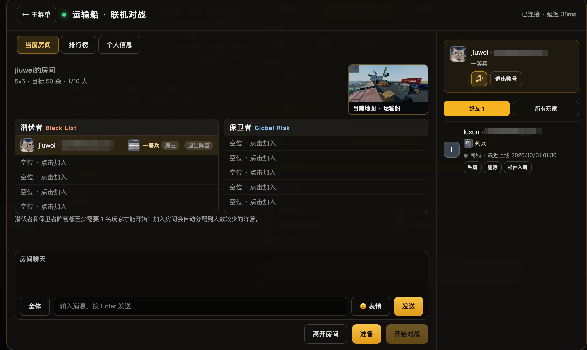
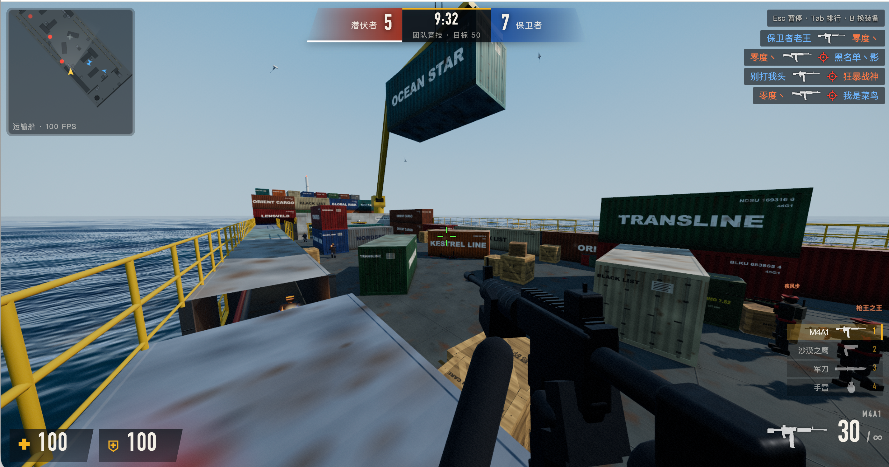

# 运输船 · 联机对战

浏览器中的运输船团队竞技游戏。玩家通过邮箱注册、登录，创建或加入房间，选择潜伏者或保卫者对战。一个 Node.js 进程提供网页、账号接口和 WebSocket 联机服务；SQLite 保存账号、战绩和军衔数据。

## 联机房间


## 运输船内


## 本机运行

需要 **Node.js 24 或更新版本**。在项目根目录执行：

```bash
cd server
npm ci
npm start
```

然后打开 [http://localhost:8787/transport-ship-mp.html](http://localhost:8787/transport-ship-mp.html)。macOS 可双击 `启动联机.command`，Windows 可双击 `start-windows.bat`；关闭启动器窗口即停止服务。

**首次注册前必须配置 SMTP 邮件服务。** 注册验证码、找回密码和离线好友邀请都需要发信账号。手动运行 `npm start` 或使用 Windows 启动器时，在启动进程的环境中设置 `SMTP_HOST`、`SMTP_PORT`、`SMTP_USER`、`SMTP_PASS`、`SMTP_FROM`；[`.env.example`](.env.example) 是变量模板，程序不会自动读取 `.env`。macOS 启动器和 Linux 部署脚本读取 `deploy/config.env`。具体示例见[邮箱配置](docs/自行部署.md#配置邮箱注册与找回密码)。没有 SMTP 时，已有账号仍可登录，但新用户无法注册。

联机开局至少需要两名玩家分别登录，并且两个阵营各有一名真人玩家。单机模式支持 bot；联机房间不使用 bot 补位。

## 部署到服务器

单台 Linux 服务器可用 `./deploy/install.sh` 安装依赖并生成游戏脚本，再配置 `deploy/config.env`，用 `./deploy/start.sh` 启动。对公网提供登录服务时，请配置 HTTPS 反向代理和 `PUBLIC_ORIGIN`。完整步骤、更新、备份和排障见[自行部署](docs/自行部署.md)。

房间、在线状态和进行中的比赛保存在**单个服务进程的内存**中，重启后会清空；账号、历史战绩及已完成结算保存在 SQLite。当前不能直接部署多个服务实例来共享房间。

## 功能与文档

- 支持 4v4、5v5、6v6、8v8 房间，以及邀请、好友私聊、中途加入和排行榜；操作与规则见[游戏玩法](docs/游戏玩法.md)。
- 真人伤害由服务端计算，客户端上报位置和视角；经验计算见[军衔与经验系统设计](docs/军衔与经验系统设计.md)。
- 维护现有服务器可参考[远程部署](docs/自行部署.md#从本地一条命令部署到现有服务器)。
- 参与开发请阅读[贡献指南](CONTRIBUTING.md)和[项目开发约定](AGENTS.md)；安全问题见[安全报告方式](SECURITY.md)。

## 开发与验证

`src/client/` 是游戏源码，`shared/maps/` 存放两端共用的地图配置；`scripts/build-game.cjs` 将它们生成到被 Git 忽略的 `web/game.js`。`web/` 是页面与联机界面，`server/` 是 HTTP、WebSocket 和 SQLite 服务，`deploy/` 是部署脚本。

在 `server/` 目录执行：

```bash
npm run build:game  # 修改客户端或地图后生成 web/game.js
npm run check:game  # 检查产物与源码一致
npm run test:data   # 运行数据和游戏逻辑测试
```

`npm start` 和本机启动器会自动构建游戏脚本；直接执行 `node server.js` 前需自行构建。运行中的服务提供 `/health` 健康检查和 `/web/testbed.html` 开发测试台。

代码采用 [MIT 许可证](LICENSE)。仓库中的音乐、地图截图、军衔图片和第三方代码仍需分别核实再分发权利，见[素材授权清单](docs/素材授权清单.md)；在核实前，不应将项目视为已具备完整的公开分发授权。
